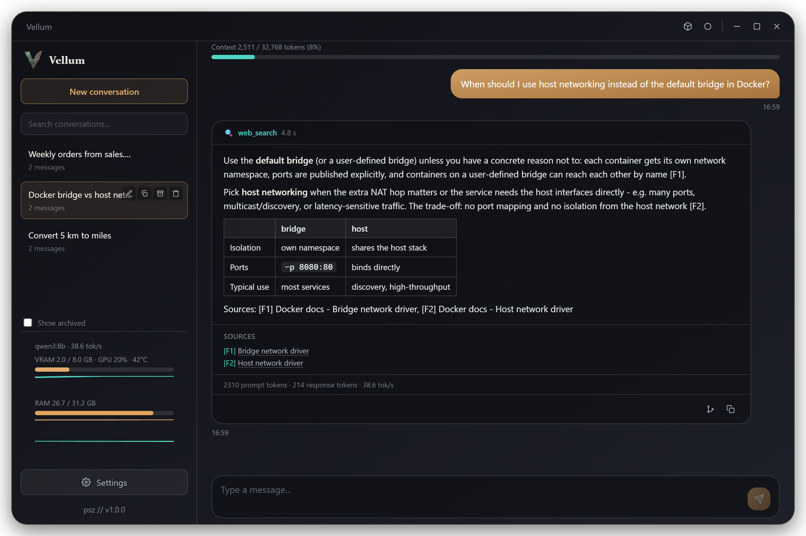
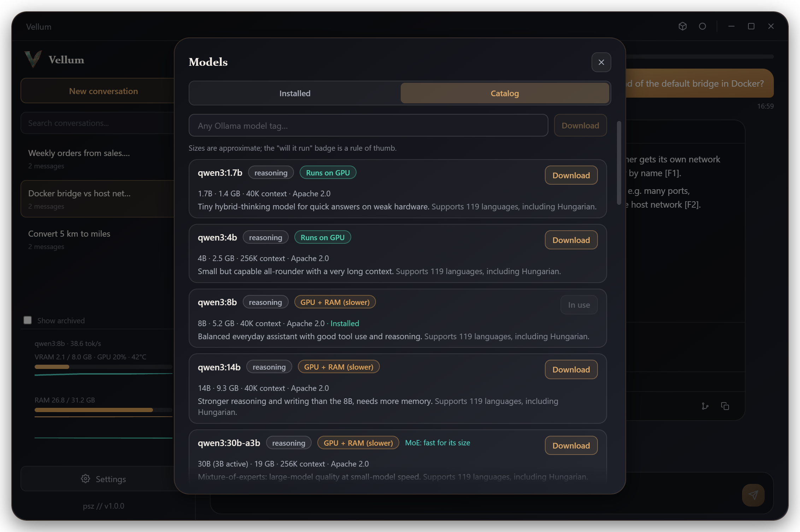
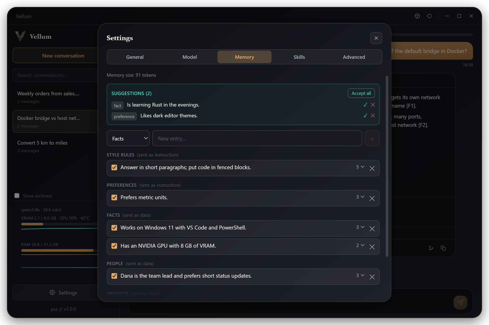
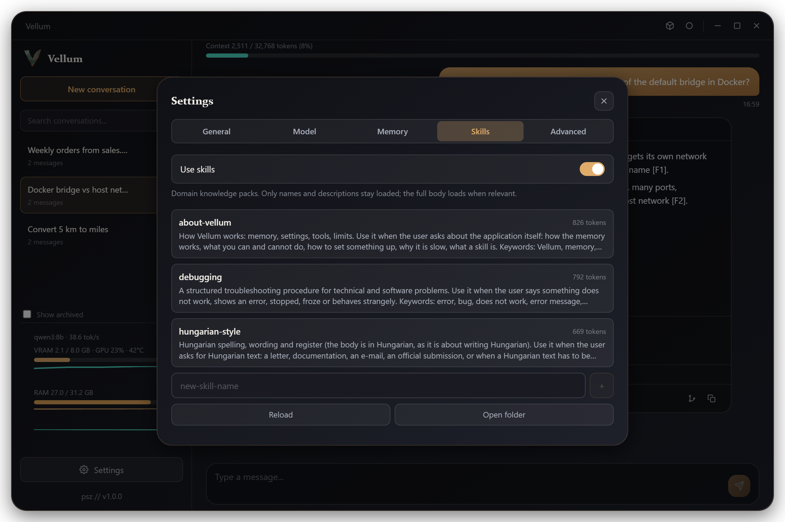
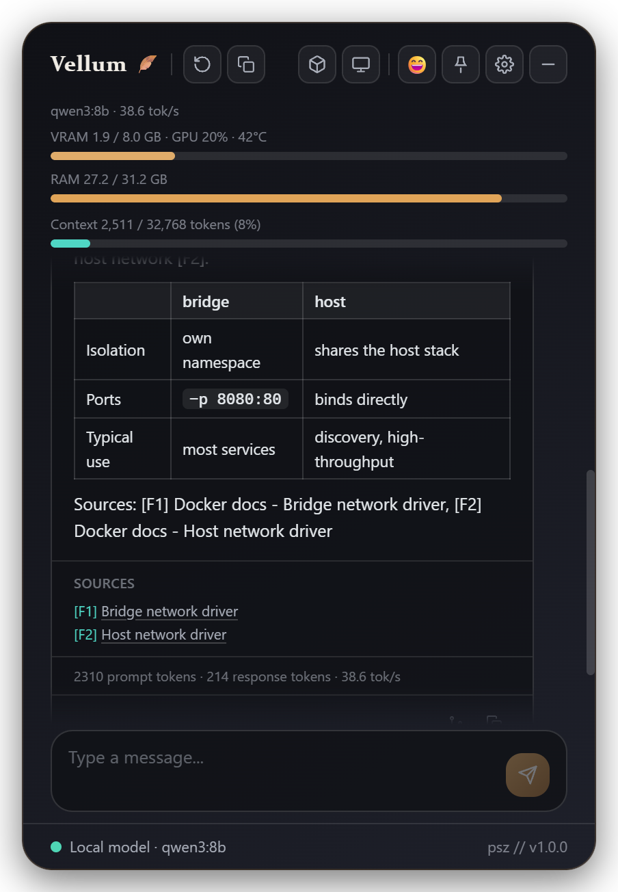
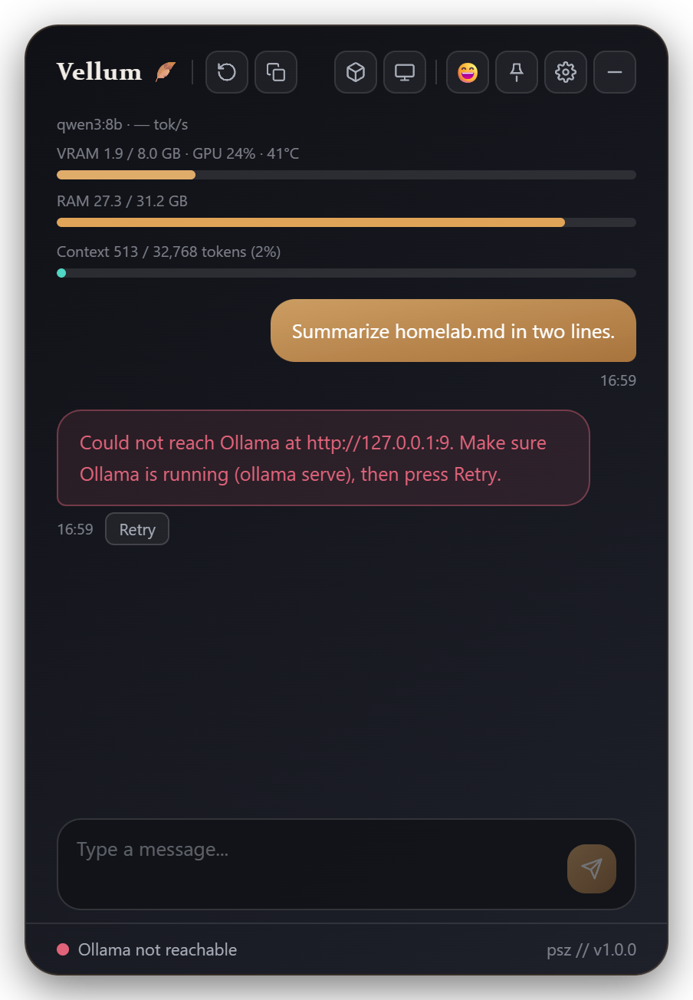
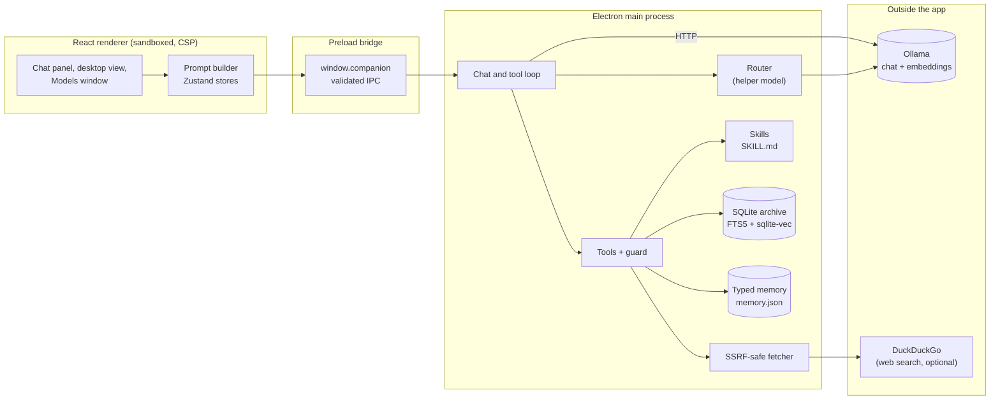

<div align="center">


# Vellum

**Local AI assistant on your own Ollama model: searchable archive, typed memory, guarded tools**


[Features](#features) · [Screenshots](#screenshots) · [Architecture](#architecture) · [Installation](#installation)

</div>

<p align="center">
  
</p>

## The problem

Running a model locally keeps your data on your PC, but a plain chat front end forgets everything between
sessions and offers no way to find an old answer. Small local models are also unreliable tool users: they pass
wrong arguments, repeat the same call or loop, and any web page or file they read can carry instructions that try
to take over the conversation. Choosing a model is guesswork too, since it is hard to tell before a download of
several gigabytes whether it will fit in the GPU.

## The solution

Vellum is a Windows desktop assistant that runs on your own [Ollama](https://ollama.com) model, with no cloud
and no API key; the only outside traffic is the optional web search. Every conversation goes into a SQLite
archive with full-text and semantic search, memory is typed and only grows with your approval, and tool calls pass
through a guard layer built for small models. A Models window lists, downloads and removes models and estimates
whether each one will run on your hardware. It grew out of [Haverom](https://github.com/piszabolcs/haverom), the
lightweight floating companion.

## Features

- **Streaming chat with real state.** Collapsible thinking block, token statistics, a context meter from Ollama's own token counts, automatic fallback to a smaller context and an idle timeout instead of a hang.
- **Searchable conversation archive.** Every conversation is stored in SQLite with FTS5 search; rename, archive, fork from any answer and export as Markdown; titles come from a helper model.
- **Semantic recall.** Messages are chunked and embedded (`bge-m3` by default) into `sqlite-vec`, so the model can search earlier conversations by meaning and keyword (hybrid search with reciprocal rank fusion).
- **Typed, approval-based memory.** Facts, people, projects, preferences and style rules, each with a priority; facts reach the model as data, preferences and style as instructions, and the model can only *suggest* new entries.
- **Guarded tools for small models.** Web search with numbered sources, date, calculator with unit conversion (no `eval`), memory, read-only file access inside one chosen folder, artifacts and skills; a router picks the tools, arguments are validated with zod and call limits stop loops.
- **Agent Skills.** Open `SKILL.md` format with YAML frontmatter; only names and descriptions stay in the prompt and a skill body loads when the router asks for it; three bundled skills.
- **Models window.** Installed models with Use and Delete, a catalog of about 20 open models, downloads with live progress and a "will it run?" badge comparing model size and KV cache with your VRAM and RAM.
- **Two layouts.** A floating bubble with a chat panel, or a desktop window with the archive; tray, global hotkey, VRAM/GPU/RAM monitor, English and Hungarian UI.

## Screenshots

<table>
  <tr>
    <td align="center" width="50%"><br/><sub>Models window with the "will it run?" badge</sub></td>
    <td align="center" width="50%"><br/><sub>Typed memory with suggestions to approve</sub></td>
  </tr>
  <tr>
    <td align="center" width="50%"><br/><sub>Bundled skills</sub></td>
    <td align="center" width="50%"><br/><sub>Floating panel with sources and token statistics</sub></td>
  </tr>
  <tr>
    <td align="center" width="50%"><br/><sub>Ollama not reachable, with Retry</sub></td>
    <td align="center" width="50%"></td>
  </tr>
</table>

The screenshots come from the demo profile (`npm run seed:demo`) with a fake Ollama,
rendered off-screen; nothing in them is real user data.

## Architecture



The renderer runs with `contextIsolation`, `sandbox` and no Node integration and only talks to the main process
through the typed `window.companion` bridge; every IPC handler checks the sender and validates its arguments. In
the main process a router call on a helper model (JSON-schema output, thinking off) picks the intent, tool
categories, thinking budget and skills; the chat loop then streams from Ollama and runs only the tools offered in
that request. Large tool output is stored as an artifact, and long conversations are compacted at 75% of the
context.

## Tech stack

| Layer | Technology |
|---|---|
| Desktop shell | Electron 44, esbuild for the main and preload bundles, electron-builder (portable exe) |
| UI | React 18, Vite 5, Tailwind CSS 3, Zustand, react-markdown with GFM |
| Language and validation | TypeScript 5, zod, zod-to-json-schema, js-yaml |
| Storage | SQLite via better-sqlite3 (WAL, FTS5), sqlite-vec for vectors, JSON files written atomically |
| Model runtime | Ollama HTTP API (chat, embeddings, model management) |
| Tests and CI | Vitest, Electron smoke tests, Playwright GUI smoke test, GitHub Actions on Windows |

## Installation

Prerequisites: Windows 10 or 11 (x64), [Node.js](https://nodejs.org) 22.12 or newer (24 LTS recommended, see
`.nvmrc`) and [Ollama](https://ollama.com/download) with a chat model. `npm install` needs no build tools:
`better-sqlite3` ships an N-API prebuild and Electron downloads its own binary.

1. Pull a chat model and, for semantic search, the embedding model:
   ```bash
   ollama pull qwen3:8b
   ollama pull bge-m3
   ```
2. Clone the repository and install the dependencies:
   ```bash
   git clone https://github.com/piszabolcs/vellum.git
   cd vellum
   npm install
   ```
3. Build and start the app:
   ```bash
   npm start
   ```
4. Optional, a portable `.exe` (electron-builder downloads its tooling on first use):
   ```bash
   npm run dist
   ```

For development: `npm run dev` (Vite plus Electron), `npm test`, `npm run typecheck`, `npm run smoke:conversations`
(real SQLite and sqlite-vec under Electron, throw-away database) and `npm run smoke:gui` (Playwright drives the
built app off-screen against a fake Ollama).

## Usage

1. Open Settings > Model and pick the chat model (the default, `qwen3:30b-a3b`, needs about 17 GB), or open the
   Models window from the cube icon to download one.
2. Ask a question in the bubble panel or the desktop view; switch web search, skills and file access on or off in
   Settings.
3. Review memory suggestions under Settings > Memory and accept the ones you want to keep.

To try it with sample data first (PowerShell):

```powershell
npm run seed:demo -- C:\temp\vellum-demo
$env:VELLUM_PROFILE_DIR = 'C:\temp\vellum-demo'; npm start
```

Data lives in `%APPDATA%\Vellum\`: `settings.json`, `memory.json` (with `memory.json.bak`), `vellum.db` (SQLite,
WAL) and `skills\` (editable copies of the bundled skills). `VELLUM_PROFILE_DIR` points it to a different parent
folder. The data is not encrypted; it is protected by your Windows account.

Security notes: the model, downloaded pages, files and skills are treated as untrusted input. Web downloads reject
loopback, private, link-local and reserved address ranges on every hop and connect only to the validated address;
the model cannot choose a URL, only search results are downloaded. External text reaches the model inside "data,
not instructions" frames, Markdown images are shown as links and never loaded, no tool writes files or runs
commands, and `save_memory` needs your confirmation. The file tool is read-only and refuses secret-looking files,
binaries and files over 5 MB. Known limits: HTML extraction runs on the main thread, search queries go to
DuckDuckGo, and a prompt injection can still steer the content of an answer.

## Project structure

```text
vellum/
├── electron/      # main process: chat and tool loop, router, SQLite archive, memory, fetcher, skills
│   ├── tools/       # web search, calculator, files, memory, artifact and skill tools, guard
│   └── schemas/     # JSON schemas for structured model output
├── src/           # React renderer
│   ├── components/  # chat, desktop shell, settings, memory editor, Models window
│   ├── store/       # Zustand stores
│   ├── providers/   # Ollama and mock providers
│   ├── data/        # curated model catalog
│   └── utils/       # context usage, model fit estimate, formatting
├── skills/        # bundled skills, copied to the profile on first start
├── scripts/       # smoke tests, demo seed, structured-output and IPC checks
├── public/        # app logo and icon
└── docs/          # logo and README screenshots
```

## Roadmap

- [ ] Index your own documents and folders, not only conversations and stored artifacts
- [ ] MCP server support for external tools
- [ ] Image input for vision models
- [ ] Move HTML extraction off the main thread so a hostile page cannot stall the UI

## License

MIT, see [LICENSE](LICENSE). Third-party packages keep their own licenses (MIT, Apache-2.0, BSD); the Electron
runtime ships the Chromium license notices with its binary. Ollama and the models you run with it are separate
software with their own licenses.

---

<div align="center">
<sub>Built by Szabolcs Pintér · <a href="https://github.com/piszabolcs">GitHub</a> · <a href="https://www.linkedin.com/in/piszabolcs">LinkedIn</a></sub>
</div>
